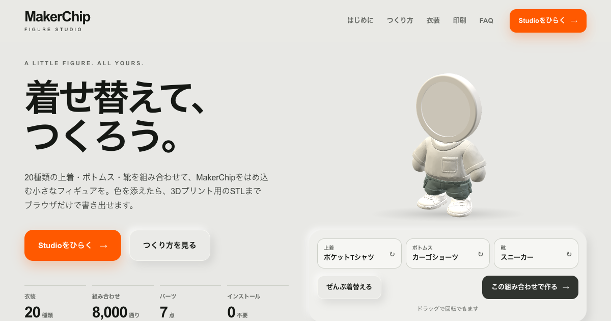

# MakerChip Figure Studio

20種類の上着・ボトムス・靴を着せ替えて、[MakerChip](https://makerchip.app/)をはめ込む小さなフィギュアをつくるブラウザ・ジェネレーター。色を添えて、3Dプリント用のSTLや色付き3MFまでブラウザだけで書き出せます。

**公開サイト: https://y-morishita-biz.github.io/makerchip-figure-studio/**
(Studioへの直リンク: <https://y-morishita-biz.github.io/makerchip-figure-studio/app/>)



## できること

- **着せ替え:** 上着・ボトムス・靴を、線画を見ながら矢印または一覧から選ぶ。20衣装 × 3パーツで8,000通り
- **3Dで仕上げる:** 「これで作る」で同じ場所に3Dが現れる。パーツのチップか3Dの部位をタップして色を選ぶ
- **書き出し:** 部品ごとのSTLと設定JSONのZIP、または色付き3MF(パーツごとの色を持ち、180 mm角のプレートに配置済み)
- **クリアランス調整:** 首・腰・左右の足の穴を接続ごとに調整。設定はJSONで保存・読込でき、ブラウザにも自動保存
- **インストール不要:** 形状の生成はブラウザ内(three.js + Manifold WebAssembly)で行い、データをサーバーへ送らない

フィギュアは約2頭身、全高約97 mm。頭のリングは直径40 mm・厚さ3 mmのチップに合わせて設計しています。後リングは指で回して外せるねじ式で、チップを交換できます。

## 印刷について

- 確認している環境: Bambu Lab A1 mini / PLA / 0.4 mmノズル / テクスチャPEI
- 書き出すのは形状・色・配置だけです。プリンタ・材料・積層・サポートなどの設定は、お使いの環境に合わせてスライサーで見直してください
- クリアランスの初期値(腰・左右の足 片側0.075 mm、首 0 mm)は暫定値です。まず1組を刷って差し込み具合を確かめ、Studioの「パーツ・サイズを調整」で合わせてください
- 色付き3MFはMaterials拡張の`m:colorgroup`で色を持ちます。Bambu Studioでは開くと色の割り当て画面が出て、手持ちのフィラメントへ対応づけられます

## 構成

```text
site/     紹介ページ(公開サイトの /)
app/      Studio本体(/app/)。Vite + three.js + manifold-3d
scripts/  build-pages.mjs: site/ と app のビルドを _site/ へ組み立てる
.github/workflows/deploy.yml: main への push で GitHub Pages へ公開
```

## ローカルで動かす

Node.js 22.12以降。

```sh
cd app
npm ci
npm test          # 形状・設定・3MFのテスト
npm run dev       # http://127.0.0.1:5173
```

公開サイトと同じ構成(`/`=紹介ページ、`/app/`=Studio)で確かめる場合:

```sh
node scripts/build-pages.mjs
python3 -m http.server 4175 --bind 127.0.0.1 --directory _site
```

ブラウザテストは`app/`で`npm run test:browser`(既定は開発サーバー)。組み立てた`_site/`に対しては`TEST_URL=http://127.0.0.1:4175/app/ PAGES_URL=http://127.0.0.1:4175/ npm run test:browser`。詳細は[app/README.md](app/README.md)。

## ライセンス

[MIT License](LICENSE)。コード、部品メッシュ、線画を含みます。サードパーティのソフトウェアは[THIRD_PARTY_NOTICES.md](THIRD_PARTY_NOTICES.md)を参照してください。

MakerChipは[makerchip.app](https://makerchip.app/)で紹介されているメイカー向けトークンの名称です。本プロジェクトはmakerchip.appの運営者とは関係ありません。

制作: penomo / dotting dots ・ [X @penomo](https://x.com/penomo)
